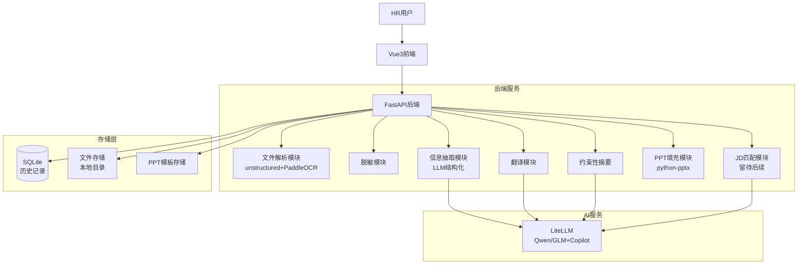
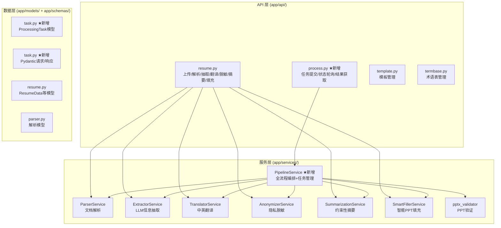
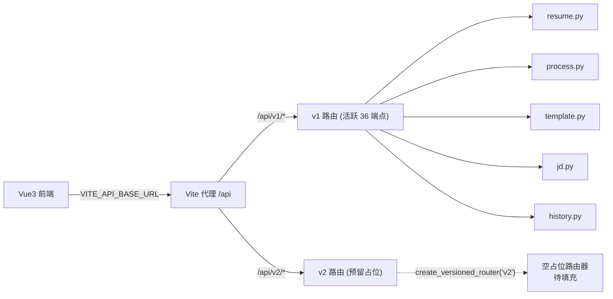
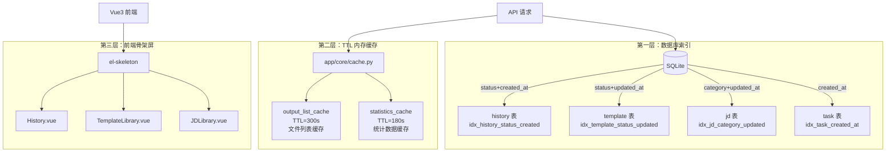

# 项目架构文档

## 系统架构图



## 数据库模式图

待补充（完成数据模型后更新）

## 服务架构图



## 目录结构

```
ai_resume/
├── backend/                 # 后端服务
│   ├── app/
│   │   ├── api/            # 路由层
│   │   │   ├── resume.py   # 简历处理API (解析/抽取/翻译/脱敏/摘要/填充)
│   │   │   ├── process.py  # ★ Pipeline编排API (任务提交/状态/结果)
│   │   │   ├── template.py # 模板管理API ★ 步骤4.5 补全CRUD
│   │   │   ├── jd.py       # JD管理API ★ 步骤4.5 补全CRUD
│   │   │   ├── history.py  # 历史记录API ★ 步骤4.5 补全CRUD
│   │   │   ├── termbase.py # 术语表API
│   │   │   └── __init__.py # 路由注册 ★ 步骤4.5 注册jd+history
│   │   ├── schemas/        # Pydantic模型
│   │   │   ├── resume.py   # 简历数据模型 (ResumeData/请求/响应)
│   │   │   ├── task.py     # ★ 任务模型 (提交请求/状态响应/结果响应)
│   │   │   ├── parser.py   # 解析模型
│   │   │   ├── template.py # 模板模型 ★ 步骤4.5
│   │   │   ├── jd.py       # JD模型 ★ 步骤4.5
│   │   │   ├── history.py  # 历史模型 ★ 步骤4.5
│   │   │   └── validation.py
│   │   ├── services/       # 业务逻辑层
│   │   │   ├── pipeline_service.py    # ★ Pipeline编排 (步骤2.10)
│   │   │   ├── parser_service.py      # 文档解析 (步骤1)
│   │   │   ├── llm_service.py         # LLM调用封装
│   │   │   ├── extractor_service.py   # 信息抽取 (步骤2)
│   │   │   ├── translator_service.py  # 翻译服务 (步骤3)
│   │   │   ├── anonymizer_service.py  # 脱敏服务 (步骤3)
│   │   │   ├── summarization_service.py # 摘要服务 (步骤4)
│   │   │   ├── smart_filler_service.py  # 智能PPT填充 (步骤6)
│   │   │   ├── filler_service.py      # PPT填充基础版
│   │   │   ├── advanced_smart_filler.py # 高级填充逻辑
│   │   │   ├── template_config.py     # 模板配置
│   │   │   ├── template_service.py    # 模板CRUD ★ 步骤4.5
│   │   │   ├── jd_service.py          # JD CRUD ★ 步骤4.5
│   │   │   ├── history_service.py     # 历史查询 ★ 步骤4.5
│   │   │   └── pptx_validator.py      # PPT验证工具
│   │   ├── models/         # 数据模型层 (SQLAlchemy)
│   │   │   ├── task.py     # ★ 处理任务表 (ProcessingTask)
│   │   │   ├── database.py # 数据库配置
│   │   │   ├── history.py  # 历史记录模型
│   │   │   ├── template.py # 模板模型 ★ 步骤4.5
│   │   │   └── jd.py       # JD模型 ★ 步骤4.5
│   │   └── core/           # 核心配置
│   │       ├── config.py    # ★ 应用配置 (pydantic-settings, 从.env加载)
│   │       └── cache.py     # ★ TTL 内存缓存 (步骤4.8, 线程安全 LRU 过期)
│   ├── .env                 # ★ 环境变量 (端口/CORS/数据库/LLM等)
│   ├── run_server.py        # ★ 启动脚本 (从config读取host/port/reload)
│   ├── templates/          # PPT模板文件
│   ├── data/               # 数据存储目录
│   ├── output/             # 输出文件目录
│   ├── uploads/            # 上传文件目录
│   ├── tests/              # 测试目录
│   │   ├── test_pipeline.py        # ★ Pipeline集成测试
│   │   ├── test_complete_integration.py
│   │   ├── test_parser.py
│   │   ├── test_extractor.py
│   │   └── ...
│   └── requirements.txt
├── frontend/               # 前端应用
│   ├── src/
│   │   ├── views/          # 页面组件
│   │   ├── components/     # 可复用组件
│   │   ├── stores/         # Pinia状态管理
│   │   ├── api/            # API封装
│   │   ├── types/          # TypeScript类型
│   │   └── utils/          # 工具函数
│   └── package.json
└── memory-bank/            # 项目文档
    ├── architecture.md     # 本文档
    ├── design-document.md  # 产品设计
    ├── tech-stack.md       # 技术栈
    ├── implementation-plan-backend.md  # 后端实施计划
    ├── implementation-plan-frontend.md # 前端实施计划
    └── progress.md         # 进度跟踪

---

## 逐文件角色说明（步骤4.6 新增）

以下按目录对每个核心文件进行职责说明，供后续开发者快速定位代码。

### `backend/app/api/` — 路由层（Router）

| 文件 | 职责 | 关键端点 |
|------|------|----------|
| `__init__.py` | 创建根 `APIRouter`，注册所有子路由（resume/template/termbase/process/jd/history），统一前缀 `/api/v1` | 路由注册入口 |
| `resume.py` | 简历处理全流程 API：上传（校验类型/大小/空文件）、解析、抽取、翻译、脱敏、摘要、填充 | `POST /upload` `POST /parse` `POST /extract` `POST /translate` `POST /anonymize` `POST /summarize` `POST /fill` |
| `process.py` | Pipeline 任务编排 API：提交异步任务、轮询状态（含 steps[] 进度）、获取结果、下载文件 | `POST /process` `GET /process/{task_id}` `GET /process/{task_id}/result` `GET /process/{task_id}/download` |
| `template.py` | 模板库 CRUD：列表、详情、上传模板文件、删除（DB+文件）、激活/停用切换 | `GET /template/list` `GET /template/{id}` `POST /template/upload` `DELETE /template/{id}` `PUT /template/{id}/status` |
| `jd.py` | JD 库 CRUD：列表（支持 category 筛选）、详情、创建、更新、删除、岗位匹配（预留） | `GET /jd/list?category=IT` `GET /jd/{id}` `POST /jd/create` `PUT /jd/{id}` `DELETE /jd/{id}` |
| `history.py` | 历史记录查询：分页列表（支持 status 筛选）、详情、统计（总数/成功率/本月）、删除 | `GET /history/list` `GET /history/{id}` `GET /history/statistics` `DELETE /history/{id}` |
| `termbase.py` | 术语表管理 API（预留） | - |

### `backend/app/services/` — 业务逻辑层（Service）

| 文件 | 职责 | 关键依赖 |
|------|------|----------|
| `pipeline_service.py` | **核心编排器**：顺序执行解析→抽取→翻译+脱敏→摘要→填充(步骤5预留)，管理任务生命周期，实时更新步骤状态和耗时 | ParserService, ExtractorService, TranslatorService, AnonymizerService, SummarizationService, SmartFillerService |
| `parser_service.py` | 文档解析：PDF/DOCX → 纯文本，使用 unstructured 库（PyMuPDF 备选），返回 `(text, pages)` | unstructured / pymupdf4llm / python-docx |
| `llm_service.py` | LLM 调用封装：统一 LiteLLM 调用，自动为 doubao 追加 `openai/` 前缀（火山方舟 Ark endpoint 兼容），支持 JSON/文本输出 | LiteLLM, doubao-seed-2-0 |
| `extractor_service.py` | 信息抽取：LLM 从原始文本提取 ResumeData 结构化字段 | llm_service |
| `translator_service.py` | 中英互译：批量翻译 ResumeData 所有文本字段 | llm_service |
| `anonymizer_service.py` | 隐私脱敏：姓名→拼音，公司→Company A/B/C，移除电话/邮箱/年龄/地址 | 基于规则 + LLM 辅助 |
| `summarization_service.py` | 约束性摘要：语法修正、格式统一、冗余删除、句式统一，保留关键信息 | llm_service |
| `smart_filler_service.py` | 智能 PPT 填充：动态多行填充 + 字号自适应 + 重叠检测 + 分页 | python-pptx |
| `filler_service.py` | PPT 填充基础版：按配置映射字段到形状 | python-pptx, template_config |
| `advanced_smart_filler.py` | 高级填充逻辑：复杂模板布局处理 | smart_filler_service |
| `template_config.py` | 模板配置：定义字段→形状映射关系 | JSON 配置文件 |
| `template_service.py` | 模板 CRUD：文件上传存盘+DB记录，删除时清理文件，激活/停用状态切换 | SQLAlchemy, 本地文件系统 |
| `jd_service.py` | JD CRUD：创建/更新/删除/列表（分类筛选）/使用计数 | SQLAlchemy |
| `history_service.py` | 历史查询：分页列表（状态筛选）/统计（成功率/月度）/单项详情 | SQLAlchemy |
| `pptx_validator.py` | PPT 格式验证：检查生成结果完整性 | python-pptx |

### `backend/app/models/` — 数据模型层（SQLAlchemy ORM）

| 文件 | 职责 | 对应数据库表 |
|------|------|-------------|
| `__init__.py` | 导入所有模型 + `Base.metadata.create_all(bind=engine)` 自动建表 | - |
| `database.py` | 数据库连接：`create_engine` + `SessionLocal` + `Base` | SQLite: `backend/data/resume_converter.db` |
| `task.py` | 处理任务模型：task_id/status/progress/steps_json/创建时间/完成时间 | `processing_tasks` |
| `template.py` | 模板模型：name/category/version/file_path/status/时间戳 | `templates` |
| `jd.py` | JD 模型：title/category/language/description/is_hot/usage_count/last_used/时间戳 | `jds` |
| `history.py` | 历史记录模型：关联 task_id 的处理历史 | `history` |

### `backend/app/schemas/` — 数据契约层（Pydantic）

| 文件 | 职责 | 关键模型 |
|------|------|----------|
| `resume.py` | 简历数据：ResumeData、ExtractionRequest/Response、TranslationRequest/Response、AnonymizationRequest/Response、TransformRequest/Response、SummarizationRequest/Response、FillerRequest/Response | 含 `tech_skills`/`lang_skills` union type + field_validator 归一化 |
| `task.py` | 任务模型：PipelineSubmitRequest、TaskStatusResponse（含 steps[]）、TaskResultResponse、TaskListResponse | Pipeline 核心协议 |
| `parser.py` | 解析模型：ParseRequest/Response | 文档解析协议 |
| `template.py` | 模板模型：TemplateResponse、TemplateUpdateRequest | - |
| `jd.py` | JD 模型：JDCreateRequest、JDUpdateRequest、JDResponse | - |
| `history.py` | 历史模型：HistoryItemResponse、HistoryListResponse、StatisticsResponse | 分页响应 {data[],total,page,pageSize} |
| `validation.py` | 通用校验模型 | - |

### `backend/app/core/` — 核心配置

| 文件 | 职责 |
|------|------|
| `config.py` | pydantic-settings 配置加载：从 `.env` 读取 HOST/PORT/DEBUG/CORS_ORIGINS/MAX_UPLOAD_SIZE_MB/UPLOAD_DIR/OUTPUT_DIR/DATABASE_URL/LLM_MODEL/LLM_API_KEY 等全部字段 |
| `cache.py` | **TTL 内存缓存**（步骤4.8）：线程安全的 `TTLCache` 类（`threading.Lock` + 键级过期），预创建 `output_list_cache(300s)` / `statistics_cache(180s)` 两个实例。支持 `get(key)` / `set(key, value)` / `invalidate(key=None)` 操作 |

### `frontend/src/` — 前端源码

| 路径 | 职责 |
|------|------|
| `views/Home.vue` | 首页：文件上传 + 模板/JD 选择 + 语言配置 |
| `views/Processing.vue` | 处理进度页：实时步骤状态 + 下载按钮（PPTX/PDF 条件渲染） |
| `views/Preview.vue` | 结果预览页：ResumeData 展示 + 下载链接 |
| `views/History.vue` | 历史记录页：分页列表 + 状态筛选 + 统计卡片 |
| `views/TemplateLibrary.vue` | 模板库页：模板列表 + 上传 + 激活/停用 + 删除 |
| `views/JDLibrary.vue` | JD 库页：JD 列表 + 分类筛选 + 创建/编辑/删除 |
| `api/index.ts` | Axios 封装：baseURL = `/api/v1`，统一请求/响应拦截，`ApiResponse<T>` / `ApiListResponse<T>` 泛型 |
| `api/request.ts` | Axios 实例创建：baseURL 从 `import.meta.env.VITE_API_BASE_URL` 读取 |
| `stores/resume.ts` | 简历数据 Pinia Store |
| `stores/processing.ts` | 处理流程 Store：上传→提交→轮询 `setInterval(2s)` → 完成下载 |
| `types/index.ts` | TypeScript 类型：ProcessResponse/ProcessResultResponse/PipelineStep/ProcessingStatus 等 |

### 关键环境变量

| 变量 | 文件 | 用途 |
|------|------|------|
| `VITE_API_BASE_URL` | `frontend/.env.development` | 前端 API 基础路径，Vite 代理到后端 `/api/v1` |
| `PORT` / `HOST` | `backend/.env` | 后端监听地址 |
| `CORS_ORIGINS` | `backend/.env` | 允许的跨域来源列表 |
| `MAX_UPLOAD_SIZE_MB` | `backend/.env` | 上传大小限制（10MB） |
| `DATABASE_URL` | `backend/.env` | SQLite 数据库路径 |
| `LLM_MODEL` | `backend/.env` | doubao-seed-2-0-code-preview-260215（自动加 openai/ 前缀） |
| `LLM_API_KEY` | `backend/.env` | 火山方舟 Ark API Key |
| `LLM_API_ENDPOINT` | `backend/.env` | `https://ark.cn-beijing.volces.com/api/v3` |
| `API_VERSION` | `backend/.env` | API 版本号 v1（步骤4.7） |
| `VITE_API_VERSION` | `frontend/.env.development` | 前端 API 版本号 v1（步骤4.7） |
```

---

## API 版本化策略（步骤4.7）

### 概述

当前所有业务 API 挂载在 `/api/v1/` 下（共 36 个端点）。版本化策略采用 **URL 前缀版本化**，为未来 breaking changes 预留平滑升级路径。

### 架构设计



### 关键文件与职责

| 层级 | 文件 | 版本化职责 |
|------|------|-----------|
| 后端配置 | `backend/.env` | `API_VERSION=v1` — 当前活跃版本；`DEPRECATED_VERSIONS=` — 废弃列表 |
| 后端配置 | `app/core/config.py` | `api_version` / `api_version_int` / `deprecated_versions` 字段 |
| 后端路由入口 | `app/main.py` | `/api/version` — 版本发现端点；路由注册 `prefix="/api/v1"` |
| 后端路由工厂 | `app/api/__init__.py` | `create_versioned_router(version)` — 按版本号创建路由器；v1 返回活跃路由，v2+ 返回空占位 |
| 前端配置 | `frontend/.env.development` | `VITE_API_VERSION=v1` / `VITE_API_BASE_URL=/api/v1` — 升级只改这两个 |
| 前端请求 | `frontend/src/api/request.ts` | 从 `VITE_API_VERSION` + `VITE_API_BASE_URL` 联合构建 baseURL |

### 升级到 v2 步骤

| # | 操作 | 位置 |
|---|------|------|
| 1 | 创建 `app/api/v2/` 目录，实现新版路由 | 后端 |
| 2 | 在 `create_versioned_router("v2")` 中注册新路由 | `app/api/__init__.py` |
| 3 | `app.include_router(v2_router, prefix="/api/v2")` | `app/main.py` |
| 4 | `.env` 中 `API_VERSION=v2`, `DEPRECATED_VERSIONS=v1` | `backend/.env` |
| 5 | 修改 `VITE_API_BASE_URL=/api/v2` | `frontend/.env.development` |
| 6 | v1 保留至少一个大版本周期再移除 | 策略 |

### 字段向后兼容规则

| 操作 | 规则 | 示例 |
|------|------|------|
| 新增字段 | 始终 `Optional` / `?` | `new_field: Optional[str] = None` |
| 删除字段 | 先 `@deprecated` 注释，保留一个大版本再删 | 不直接删除字段 |
| 重命名字段 | 新旧字段并存一个版本 | 保留 `old_name` + `new_name` |

> ✅ v1 所有 Pydantic Schema 新增字段均已使用 `Optional` 类型，符合向后兼容要求。

### 非版本化端点

以下端点不纳入版本化，始终稳定：

| 端点 | 用途 |
|------|------|
| `GET /health` | 健康检查 |
| `GET /` | API 根信息 |
| `GET /docs` | Swagger UI |
| `GET /openapi.json` | OpenAPI JSON |
| `GET /api/version` | **版本发现**（步骤4.7 新增） |

---

## 性能优化架构（步骤4.8）

### 三层优化策略



### 第一层：数据库索引

**目的：** 加速 WHERE/JOIN/ORDER BY 查询，减少全表扫描。

| 表 | 复合索引 | 列索引 | 查询场景 |
|----|---------|--------|---------|
| `processing_history` | `(status, created_at)` | `status`, `created_at` | 按状态筛选 + 按时间排序 |
| `templates` | `(status, updated_at)` | `status`, `updated_at` | 按激活状态筛选 + 最近更新排序 |
| `jds` | `(category, updated_at)` | `category`, `updated_at` | 按分类筛选 + 最近更新排序 |
| `processing_tasks` | - | `created_at` | 按创建时间排序 |

> **注意：** SQLAlchemy `create_all` 不会对已存在的表添加索引。存量数据库需手动执行 `CREATE INDEX IF NOT EXISTS`（已在步骤4.8中执行 10 条语句完成迁移）。

### 第二层：TTL 内存缓存 (`app/core/cache.py`)

**设计：**

```python
class TTLCache:
    def __init__(self, ttl_seconds: int = 300):
        self._ttl = ttl_seconds
        self._store: Dict[str, Tuple[float, Any]] = {}  # (expire_time, value)
        self._lock = threading.Lock()  # 线程安全
```

**缓存实例与策略：**

| 实例 | TTL | 用途 | 缓存键 | 缓存内容 |
|------|-----|------|--------|---------|
| `output_list_cache` | 300s (5min) | 输出文件列表 | `"output_files"` | 文件列表 JSON |
| `statistics_cache` | 180s (3min) | 统计聚合数据 | `"statistics"` | 3合1查询结果 |

**适用原则：**
- ✅ 缓存低频变更的查询结果（文件列表 < 生成完成后不变）
- ✅ 缓存聚合计算（statistics 聚合查询代价高）
- ❌ 不缓存高频 CUD 数据（template/jd/history 的 CRUD 列表）

**失效策略：**
- TTL 自动过期 → 下一次请求重新计算并缓存
- `invalidate(key)` 手动失效指定键
- `invalidate()` 无参数 = 清空全部缓存

### 第三层：前端骨架屏

**实现模式：** 所有骨架屏使用同一 `<template v-if="store.loading">` 模式：

```vue
<template v-if="store.loading">
  <el-skeleton :rows="6" animated />
</template>
<template v-else>
  <!-- 原有内容（含 mock 数据） -->
</template>
```

**涉及页面：**

| 页面 | Store | 骨架内容 |
|------|-------|---------|
| `History.vue` | `useHistoryStore` | 3 统计卡片 + 筛选栏 + 列表行 |
| `TemplateLibrary.vue` | `useTemplateStore` | 3 统计卡片 + 模板列表 |
| `JDLibrary.vue` | `useJDStore` | 4 统计卡片 + JD 列表 |

> **设计决策：** 骨架屏仅包裹加载态，`v-else` 分支保留原有 mock 数据展示。这意味着当 `loading=true` 时显示骨架屏，`loading=false` 后显示 mock 数据（未接入真实 API）。后续接入真实数据时只需替换 `v-else` 分支内容，骨架屏逻辑无需改动。

### 统计查询优化（`history_service.py`）

**优化前（3 次 COUNT 查询）：**
```python
total = db.query(ProcessingHistory).count()
succeeded = db.query(ProcessingHistory).filter(status=="completed").count()
monthly = db.query(ProcessingHistory).filter(created_at >= month_start).count()
```

**优化后（1 次 CASE WHEN 聚合查询）：**
```python
stats = db.query(
    func.count(ProcessingHistory.id).label("total"),
    func.sum(case((ProcessingHistory.status == "completed", 1), else_=0)).label("succeeded"),
    func.sum(case((ProcessingHistory.created_at >= month_start, 1), else_=0)).label("monthly"),
).first()
```

### 性能基准

| 端点 | 目标 | 实测 | 优化手段 |
|------|------|------|---------|
| GET /template/list | <500ms | ~250ms | 数据库索引 |
| GET /jd/list | <500ms | ~250ms | 数据库索引 |
| GET /history/list | <500ms | ~250ms | 数据库索引 |
| GET /history/statistics | <500ms | ~219ms | CASE WHEN 聚合 + TTL 缓存 |
| GET /resume/fill/outputs | <500ms | ~218ms | TTL 缓存 + 文件迭代优化 |

---

## 处理流程

```
上传简历 → POST /api/v1/process (提交任务)
    ↓
[后台异步执行 Pipeline]
    ↓
[1] 文档解析 (ParserService) → 0.4s
    ↓
[2] LLM结构化抽取 (ExtractorService) → 38s
    ↓
[3] 翻译+脱敏 (AnonymizerService + TranslatorService) → 11s
    ↓
[4] 约束性摘要 (SummarizationService) → 62s
    ↓
[5] 岗位匹配评估 [跳过，待后续开发]
    ↓
[6] PPT模板填充 (SmartFillerService) → 0.3s
    ↓
     └─ PPT验证 (validate_pptx)
    ↓
轮询 GET /api/v1/process/{task_id} → 状态/进度
    ↓
获取 GET /api/v1/process/{task_id}/result → 下载链接
```

## 核心模块说明

### 文档解析模块（ParserService）
**文件**: `app/services/parser_service.py`  
**职责**: Pipeline 步骤 1 - 文档解析

**功能**:
- 支持 PDF、DOCX、图片格式解析
- 主解析器: unstructured 库
- OCR 回退: PaddleOCR（扫描版 PDF/图片）
- 自动降级策略：unstructured 失败 → OCR

**数据流程**:
```
上传文件 → 文件类型检测 → [unstructured解析] → 文本提取
                              ↓ (失败)
                          [OCR识别]
```

**关键文件**:
- `app/schemas/parser.py`: 解析相关 Pydantic 模型
- `app/api/resume.py`: 解析 API 端点（/parse, /upload-and-parse）
- `tests/test_parser.py`: 解析服务验证测试

### LLM调用模块（LLMService）
**文件**: `app/services/llm_service.py`  
**职责**: 统一的LLM调用封装，为其他服务提供AI能力

**功能**:
- 封装 LiteLLM 调用接口
- 支持文本和JSON格式输出
- 实现智能JSON提取和错误处理
- 提供模拟响应用于开发测试

**数据流程**:
```
服务调用 → 构建Prompt → LLM调用 → 响应解析 → 返回结果
```

**模型配置**（doubao/火山方舟 Ark）:

doubao 使用火山方舟的 OpenAI 兼容 API，LiteLLM 需要通过 `openai/` 前缀识别 provider。
`llm_service.py` 中已实现自动前缀追加逻辑：

```python
# 当配置了自定义 endpoint 且模型名不含 provider 前缀时，自动添加 openai/
if use_model and settings.llm_api_endpoint and "/" not in use_model:
    use_model = f"openai/{use_model}"
```

- `.env` 中只需配置 `LLM_MODEL=doubao-seed-2-0-code-preview-260215`（无需手动加前缀）
- `LLM_API_ENDPOINT=https://ark.cn-beijing.volces.com/api/v3`
- 实测响应速度：信息抽取 ~29s，翻译 ~15s，摘要 ~69s

### 信息抽取模块（ExtractorService）
**文件**: `app/services/extractor_service.py`  
**职责**: Pipeline 步骤 2 - LLM结构化抽取

**功能**:
- 使用 LLM 从文本中智能提取简历字段
- 支持完整的 ResumeData 结构映射
- 实现按时间倒序排列经历条目
- 处理信息缺失的边界情况

**数据流程**:
```
原始文本 → LLM Prompt构建 → 结构化抽取 → ResumeData验证
```

**关键文件**:
- `app/schemas/resume.py`: 简历结构化模型（ResumeData, ExtractionRequest/Response）
  - `tech_skills` / `lang_skills` 使用 `Optional[Union[str, List[str]]]` + `@field_validator` 自动将数组归一化为逗号分隔字符串，兼容 LLM 返回的两种格式
- `app/api/resume.py`: 信息抽取 API 端点（/extract, /parse-and-extract）
- `tests/test_extractor.py`: 信息抽取服务验证测试

### 翻译服务模块（TranslatorService）
**文件**: `app/services/translator_service.py`  
**职责**: Pipeline 步骤 3 的一部分 - 中英文互译

**功能**:
- 使用 LLM 进行专业简历翻译
- 支持中文 ↔ 英文双向翻译
- 保持专业术语和格式准确性
- 支持整个简历数据的批量翻译

**数据流程**:
```
ResumeData → 检测源语言 → 逐字段翻译 → 重组ResumeData
```

**关键文件**:
- `app/schemas/resume.py`: 翻译相关模型（TranslationRequest/Response）
- `app/api/resume.py`: 翻译 API 端点（/translate）
- `tests/test_translator.py`: 翻译服务验证测试

### 脱敏服务模块（AnonymizerService）
**文件**: `app/services/anonymizer_service.py`  
**职责**: Pipeline 步骤 3 的一部分 - 隐私脱敏

**功能**:
- 姓名脱敏: `张伟` → `Mr./Ms. Zhang`
- 敏感信息移除: 电话、邮箱、年龄、生日、地址
- 公司名映射: `阿里巴巴` → `Company A`, `腾讯` → `Company B`
- 保留: 工作经历、技能、学历背景

**脱敏规则**（来自 design-document.md 4.5.2）:
```
原始简历 → [姓名脱敏] → [移除敏感字段] → [公司名映射] → 脱敏简历
```

**关键文件**:
- `app/schemas/resume.py`: 脱敏相关模型（AnonymizationRequest/Response, TransformRequest/Response）
- `app/api/resume.py`: 脱敏 API 端点（/anonymize, /transform）
- `tests/test_anonymizer.py`, `tests/test_transform.py`: 脱敏服务验证测试

### 约束性摘要服务模块（SummarizationService）
**文件**: `app/services/summarization_service.py`  
**职责**: Pipeline 步骤 4 - 简历经历优化

**功能**（严格按照 design-document.md 4.5.3 规则）:
- 语法修正: 修正语法错误、表达不通顺的地方
- 格式统一: 统一标点符号、格式风格
- 冗余删除: 删除重复或冗余的工作内容
- 句式统一: 每段经历使用相同的句式表达（常见简历风格）
- 内容保留: 在不大幅改动候选人简历原文内容的基础上优化

**处理流程**:
```
原始经历 → [语法修正] → [格式统一] → [冗余删除] → [句式统一] → 优化后经历
```

**关键文件**:
- `app/schemas/resume.py`: 摘要相关模型（SummarizationRequest/Response）
- `app/api/resume.py`: 摘要 API 端点（/summarize）
- `tests/test_summarization.py`: 摘要服务验证测试

### PPT模板填充服务模块（FillerService）
**文件**: `app/services/filler_service.py`  
**职责**: Pipeline 步骤 6 - PPT模板填充

**功能**:
- 使用 python-pptx 库操作PPT文件
- 支持两种模板：纵向（New_Template）和横向（Onepager_Template）
- 定义Resume字段到PPT占位符的映射关系（参考 design-document.md 4.5.1）
- 格式化教育经历、工作经历、项目经历列表
- 保持模板原有样式
- 处理文本替换和格式调整

**字段映射**（严格按照 design-document.md 4.5.1）:
| 字段名 | PPT占位符 |
|--------|-----------|
| `name` | {{姓名}} |
| `anonymized_name` | {{脱敏姓名}} |
| `position` | {{职位}} |
| `technical_area` | {{技术领域}} |
| `total_exp` | {{总工作经验}} |
| `education` | {{教育经历列表}} |
| `work` | {{工作经历列表}} |
| `project` | {{项目经历列表}} |
| `tech_skills` | {{技术技能}} |
| `lang_skills` | {{语言技能}} |
| `summary` | {{个人简介}} |

**处理流程**:
```
ResumeData → [格式化列表字段] → [替换占位符] → [保存PPT] → 输出文件
```

**关键文件**:
- `app/services/template_config.py`: 模板配置管理（字段映射、模板路径）
- `app/schemas/resume.py`: PPT填充相关模型（FillerRequest/Response, OutputFileInfo, OutputFileListResponse）
- `app/api/resume.py`: PPT填充与下载 API 端点
  - `POST /fill` - 智能填充PPT（响应含 download_url, file_size）
  - `GET /fill/download/{filename}` - 下载PPT文件（支持中文文件名RFC 5987编码）
  - `GET /fill/info/{filename}` - 获取文件元信息（大小/时间/下载URL）
  - `GET /fill/outputs` - 列出所有输出文件（按修改时间倒序）
- `tests/test_filler.py`: PPT填充服务验证测试
- `tests/test_download.py`: 下载功能测试（6项全部通过）
- `templates/`: PPT模板文件存储目录
- 下载端点使用绝对路径 `OUTPUT_DIR`，不依赖工作目录

### Pipeline 编排服务模块（PipelineService） ★新增 步骤2.10
**文件**: `app/services/pipeline_service.py`  
**职责**: Pipeline 编排 - 将所有处理步骤串联为完整的异步任务流

**功能**:
- 按顺序执行 5 个处理步骤（步骤5岗位匹配跳过）
- 实时更新任务进度（每步完成后更新百分比）
- 内存任务存储 + threading.Lock 线程安全
- 支持异步后台执行（asyncio.create_task）
- 各步骤耗时统计
- 错误捕获与任务失败标记

**Pipeline 执行顺序**:
```
步骤1: 文档解析 (ParserService, async)     → raw_text
步骤2: LLM结构化抽取 (ExtractorService, async) → ResumeData
步骤3: 翻译+脱敏 (AnonymizerService sync + TranslatorService async) → ResumeData
步骤4: 约束性摘要 (SummarizationService, async) → ResumeData
步骤5: [跳过] 岗位匹配评估
步骤6: PPT模板填充 (SmartFillerService, sync) → output.pptx
       └─ PPT验证 (validate_pptx) → validation report
```

**关键文件**:
- `app/services/pipeline_service.py`: Pipeline编排核心（TaskInfo + PipelineService类）
- `app/models/task.py`: 任务数据库模型（ProcessingTask表）
- `app/schemas/task.py`: 任务相关Pydantic模型（PipelineSubmitRequest/TaskStatusResponse/TaskResultResponse）
- `app/api/process.py`: Process API 端点
  - `POST /api/v1/process` - 提交任务（异步后台执行）
  - `GET /api/v1/process/{task_id}` - 轮询状态（实时进度）
  - `GET /api/v1/process/{task_id}/result` - 获取结果（含下载链接）
  - `GET /api/v1/process` - 任务列表
- `tests/test_pipeline.py`: Pipeline集成测试（5/5通过）

**实测性能** (完整Pipeline，含LLM调用):
| 步骤 | 耗时 |
|------|------|
| 文档解析 | ~0.4s |
| LLM结构化抽取 | ~38s |
| 翻译+脱敏 | ~11s |
| 约束性摘要 | ~62s |
| PPT模板填充 | ~0.3s |
| **总计** | **~111s** |

### 文件上传模块（步骤4.2 增强）

**文件**: `app/api/resume.py` → `POST /api/v1/resume/upload`
**职责**: 简历文件上传 — 接收文件、校验合法性、存储并返回 file_id

**校验规则**（三重防护）:

| 校验项 | 规则 | 不通过返回 |
|--------|------|-----------|
| 文件类型 | 仅 `.pdf`、`.docx`、`.doc` | 400 "不支持的文件格式" |
| 文件大小 | ≤ `MAX_UPLOAD_SIZE_MB`（默认10MB） | 400 "文件大小超出限制" |
| 空文件 | `file_size > 0` | 400 "文件为空" |

**安全策略**:
- 文件名使用 UUID 重命名，防止路径遍历攻击
- 使用 `Path.suffix` 提取扩展名，统一转小写
- 先读取内容再校验大小（避免流式写入后才发现超限）
- 临时文件不保留（仅在 tests 中使用，生产由 Pipeline 清理）

**步骤4.2 修复记录**:
- 后端修复：新增文件大小校验（`MAX_UPLOAD_BYTES`）→ 之前完全缺失
- 后端修复：限制上传格式仅 PDF/Word（`ALLOWED_UPLOAD_EXTENSIONS`）→ 之前包含 JPG/PNG 等图片格式
- 后端修复：新增空文件校验 → 之前未检查
- 前端修复：移除手动 `Content-Type: multipart/form-data` → axios 自动补 boundary
- 清理：移除 `resume.py` 中未使用的 `shutil` import

**测试验证**（5/5 通过）:
| # | 场景 | 预期 | 结果 |
|---|------|------|------|
| 1 | DOCX 正常上传 | 200 + file_id | ✅ |
| 2 | .exe 不支持格式 | 400 | ✅ |
| 3 | 11MB 超大文件 | 400 "超出限制" | ✅ |
| 4 | 空文件 | 400 "文件为空" | ✅ |
| 5 | .jpg 图片格式 | 400（已排除） | ✅ |

### 前后端 Pipeline 轮询集成（步骤4.3 新增）

**涉及文件**（6 个文件修改）:

| 层级 | 文件 | 改动内容 |
|------|------|----------|
| 后端 Schema | `app/schemas/task.py` | `TaskStatusResponse` 新增 `steps: list` 字段 |
| 后端 Service | `app/services/pipeline_service.py` | `to_status_dict()` 新增 `steps` 数组计算逻辑 |
| 前端类型 | `src/types/index.ts` | `ProcessResponse` 重构 → 拆出 `ProcessResultResponse`；`PipelineStep` 增加 `key`/`skipped`；`ProcessingStatus` 重写 |
| 前端 API | `src/api/index.ts` | `upload()` 增加 `ApiResponse<UploadData>` 泛型返回类型 |
| 前端 Store | `src/stores/processing.ts` | **全面重写**：真实上传→提交→轮询 替代模拟数据 |
| 前端视图 | `src/views/Processing.vue` | 字段引用更新：`pipeline→steps`、`overall_progress→progress` 等 |

**核心数据流**:

```
用户点击"开始处理"
  → upload(file)           POST /api/v1/resume/upload → file_id
  → process(fileId, opts)  POST /api/v1/process       → task_id + steps[]
  → setInterval(2000ms)    GET /api/v1/process/{id}   → steps[] 实时更新
  → 完成/失败 → 自动停止轮询
  → fetchResult()          GET /api/v1/process/{id}/result → 下载URL
```

**steps 数组状态机**（后端 `to_status_dict()` 核心逻辑）:

| 任务状态 | 各步骤状态计算规则 |
|----------|-------------------|
| `pending` | 全部 `pending` |
| `completed` | 全部 `completed` |
| `failed` | `s["index"] < step_index` → `completed`; `s["index"] == step_index` → `failed`; 其余 `pending` |
| `processing` | `s["index"] < step_index` → `completed`; `s["index"] == step_index` → `in_progress`; 其余 `pending` |

> 🚫 步骤5（岗位匹配 `matching`）在所有状态下均返回 `skipped`

### 前后端下载集成（步骤4.4 新增）

**涉及文件**（5 个文件修改）:

| 层级 | 文件 | 改动内容 |
|------|------|----------|
| 前端类型 | `src/types/index.ts` | `ProcessingStatus` 新增下载 URL 字段（`pptx_download_url`/`pdf_download_url`/`output_filename`/`pdf_available`） |
| 前端 API | `src/api/index.ts` | `downloadPPTX()`/`downloadPDF()` 已配置 `responseType: 'blob'` + `encodeURIComponent` |
| 前端 Store | `src/stores/processing.ts` | `fetchResult()` 保存下载链接到 Store；新增 `downloadFile()` blob 下载函数 |
| 前端视图 | `src/views/Processing.vue` | 完成后显示「下载PPTX」「下载PDF」按钮（条件渲染）；修复 `startMockProcessing`/`reset` 引用 |
| 前端视图 | `src/views/Preview.vue` | **全部重写**：硬编码假数据 → Store 真实数据驱动（resumeData + 条件下载按钮 + 空状态） |

**下载数据流**:

```
任务完成 → fetchResult() → GET /api/v1/process/{id}/result
  → Store 保存: pptx_download_url, pdf_download_url, pdf_available, output_filename
  → UI: 条件渲染下载按钮 (v-if="processingStatus.pptx_download_url")
  → 用户点击下载
  → downloadFile(url) → downloadPPTX(filename) [responseType: 'blob']
  → Blob → URL.createObjectURL() → <a download> 触发 → revokeObjectURL()
```

**后端下载端点**:

| 端点 | 响应 | 说明 |
|------|------|------|
| `GET /api/v1/resume/fill/download/{filename}?format=pptx` | `application/vnd.openxmlformats-officedocument.presentationml.presentation` | PPTX 文件下载 |
| `GET /api/v1/resume/fill/download/{filename}?format=pdf` | `application/pdf` | PDF 下载（需 LibreOffice） |
| `Content-Disposition` | `attachment; filename*=UTF-8''{encoded_filename}` | RFC 5987 中文编码 |

**curl 验证结果**:

| 测试 | 预期 | 结果 |
|------|------|------|
| PPTX 下载 | 200 + 文件流 | ✅ 74,950 bytes |
| Content-Type | `application/vnd...presentation` | ✅ |
| Content-Disposition | RFC 5987 UTF-8 | ✅ `filename*=UTF-8''IAV_L%E5%85%88%E7%94%9F_...pptx` |
| PDF 下载 | 需要 LibreOffice | ⚠️ `pdf_available: false`（未安装 LibreOffice，前端自动隐藏） |

**已修复的前后端差距**:

| # | 问题 | 修复 |
|---|------|------|
| 1 | `ProcessingStatus` 缺少下载 URL 字段 | 新增 `pptx_download_url`/`pdf_download_url`/`output_filename`/`pdf_available` |
| 2 | `fetchResult()` 未保存下载链接 | 轮询完成时自动填充到 `processingStatus` |
| 3 | `Processing.vue` 引用已删除的 `startMockProcessing()` | 改为 polling 自动驱动 + 已完成时调用 `fetchResult()` |
| 4 | `Processing.vue` 引用 `reset()` 不存在 | 修复为 `resetProcessing()` |
| 5 | Store 缺少 blob 下载函数 | 新增 `downloadFile()`：`createObjectURL` → `<a download>` → `revokeObjectURL` |
| 6 | `Preview.vue` 全部硬编码 | 重写为 Store 真实数据驱动 + 条件下载 + 空状态 |

**前端适配器 `mapToProcessingStatus()`**:

```typescript
// 将后端 TaskStatusResponse 映射为前端 ProcessingStatus
function mapToProcessingStatus(resp: TaskStatusResponse): ProcessingStatus
// 映射要点：
// - progress: resp.progress (0-100)
// - steps: resp.steps (已包含每步 key/name/status/duration)
// - currentStep: resp.current_step
// - fileInfo: 从 Store 本地状态获取 (上传时已记录)
// - config: 从 Store 本地状态获取 (提交时已记录)
```

**已验证的前后端字段对齐**:

| 前端 `ProcessingStatus` | 后端 `TaskStatusResponse` | 传递路径 |
|-------------------------|---------------------------|----------|
| `progress` (number) | `progress` (int) | status 轮询 |
| `steps[]` | `steps[]` | status 轮询 |
| `currentStep` | `current_step` | status 轮询 |
| `stepIndex` | `step_index` | status 轮询 |
| `errorMessage` | `error_message` | status 轮询 |
| `elapsed` | `total_duration` 格式化 | `_formatElapsed()` |
| `fileInfo` | **本地 Store 状态** | 上传时缓存 |
| `config` | **本地 Store 状态** | 提交时缓存 |

**curl 验证记录**（4/4 通过）:

| # | 端点 | 验证点 | 结果 |
|---|------|--------|------|
| 1 | `POST /api/v1/process` | task_id + 6 步 steps 数组（matching=skipped） | ✅ |
| 2 | `GET /api/v1/process/{id}` | 步骤实时更新（parsing=completed 0.11s, extracting=failed） | ✅ |
| 3 | `GET /api/v1/process/{id}/result` | 失败任务 `success=false`，含 `error_message` | ✅ |
| 4 | `GET /api/v1/process` | 任务列表含多任务，按创建时间降序 | ✅ |

### 智能PPT填充服务模块（SmartFillerService）
**文件**: `app/services/smart_filler_service.py`  
**职责**: 增强版PPT填充 - 支持动态行克隆、智能分页、间距调整

**功能**:
- 自动克隆表格行（支持多条工作/项目/教育经历）
- 智能分页（逐模块判断溢出，自动创建新页面）
- 模块间距自动调整（≥1cm）
- 公司表格智能放置（最后一页固定位置）
- 填充后自动验证（重叠/溢出检查）

**关键文件**:
- `app/services/advanced_smart_filler.py`: 高级填充逻辑
- `app/services/pptx_validator.py`: PPT验证工具（重叠/溢出/间距检查）
- `tests/test_complete_integration.py`: 完整填充集成测试

## 更新日志

| 日期 | 更新内容 |
|------|----------|
| 2026-06-23 | 初始化架构文档，补充系统架构图和目录结构 |
| 2026-06-23 | 补充文档解析模块说明（步骤2.4完成） |
| 2026-06-24 | 补充LLM调用和信息抽取模块说明（步骤2.5完成） |
| 2026-06-24 | 补充翻译和脱敏模块说明（步骤2.6完成） |
| 2026-06-24 | 补充约束性摘要模块说明（步骤2.7完成） |
| 2026-06-24 | 补充PPT模板填充模块说明（步骤2.9完成） |
| 2026-06-24 | 记录：步骤2.8岗位匹配评估服务待后续开发 |
| 2026-07-06 | 补充Pipeline编排服务、智能PPT填充服务、任务管理模块说明（步骤2.10完成，M3达成） |
| 2026-07-06 | 更新步骤2.9下载功能：新增文件列表/元信息端点，中文文件名支持，FillerResponse增强（download_url/file_size） |
| 2026-07-07 | 补充配置管理模块说明：.env / config.py / main.py / run_server.py（步骤4.0.1完成） |
| 2026-07-07 | 补充 API 路由契约表（步骤4.1完成）：完整路由对照、请求/响应格式约定、缺失端点记录 |
| 2026-07-07 | 补充文件上传模块说明（步骤4.2完成）：上传校验规则、安全策略、前后端修复详情 |
| 2026-07-07 | 补充前后端 Pipeline 轮询集成说明（步骤4.3完成）：steps 状态机、前端适配器、字段对齐、curl 验证 |
| 2026-07-07 | 补充 LLM 模型配置（doubao/火山方舟）：LiteLLM `openai/` provider 前缀自动追加、技能字段类型兼容修复 |
| 2026-07-07 | **补充前后端下载集成说明（步骤4.4完成）**：下载数据流、端点规格、curl验证结果（74KB PPTX）、6处前后端差距修复（类型/Store/视图）、预览页重写、parser返回类型修复 |
| 2026-07-07 | **补充步骤4.5 CRUD 管理端点**：新增8个后端文件（models/schemas/services）+ 修改5个文件（API/路由/模型注册）、API 路由表更新（12个新端点标记 ✅ 步骤4.5）、响应格式契约说明、curl全量验证7/7通过 |

---

## API 路由契约（步骤4.1 锁定）

## API 路由契约（步骤4.1 锁定）

> 📋 **契约原则**：所有业务 API 统一挂载在 `/api/v1/` 下，非业务端点（`/health`、`/docs`）不在此范围。前端 `baseURL` = `/api/v1`，所有 API 路径相对于此。

### 完整路由对照表（已验证）

| 方法 | 完整路径 | 后端文件 | 前端调用 | 状态 |
|------|----------|----------|----------|------|
| `GET` | `/health` | `main.py` | — | ✅ |
| `POST` | `/api/v1/resume/upload` | `resume.py:44` | `resumeApi.upload(file)` | ✅ |
| `POST` | `/api/v1/resume/parse` | `resume.py:86` | `resumeApi.parse(fileId)` → body: `{file_id}` | ✅ 已修复 |
| `POST` | `/api/v1/resume/upload-and-parse` | `resume.py:128` | — | ✅ (快捷端点) |
| `POST` | `/api/v1/resume/extract` | `resume.py:172` | `resumeApi.extract(rawText)` → body: `{raw_text}` | ✅ 已修复 |
| `POST` | `/api/v1/resume/parse-and-extract` | `resume.py:202` | — | ✅ (快捷端点) |
| `POST` | `/api/v1/resume/translate` | `resume.py:232` | `resumeApi.translate(data)` | ✅ |
| `POST` | `/api/v1/resume/anonymize` | `resume.py:267` | `resumeApi.anonymize(data)` | ✅ |
| `POST` | `/api/v1/resume/transform` | `resume.py:295` | `resumeApi.transform(data)` → `perform_anonymization` | ✅ 已修复 |
| `POST` | `/api/v1/resume/summarize` | `resume.py:336` | — | ✅ |
| `POST` | `/api/v1/resume/fill` | `resume.py:362` | `resumeApi.fill(data)` | ✅ |
| `GET` | `/api/v1/resume/fill/download/{filename}` | `resume.py:451` | `resumeApi.downloadPPTX/PDF(name)` | ✅ |
| `GET` | `/api/v1/resume/fill/info/{filename}` | `resume.py:507` | — | ✅ |
| `GET` | `/api/v1/resume/fill/outputs` | `resume.py:559` | — | ✅ |
| `GET` | `/api/v1/resume/download/{file_id}` | `resume.py:616` | — | ⚠️ 开发中 |
| `POST` | `/api/v1/process` | `process.py:21` | `resumeApi.process(data)` | ✅ |
| `GET` | `/api/v1/process/{task_id}` | `process.py:68` | `resumeApi.getProcessStatus(id)` | ✅ |
| `GET` | `/api/v1/process/{task_id}/result` | `process.py:89` | `resumeApi.getProcessResult(id)` | ✅ |
| `GET` | `/api/v1/process` | `process.py:112` | — | ✅ |
| `GET` | `/api/v1/template/list` | `template.py` | `templateApi.list()` | ✅ 步骤4.5 |
| `GET` | `/api/v1/template/{id}` | `template.py` | `templateApi.get(id)` | ✅ 步骤4.5 |
| `POST` | `/api/v1/template/upload` | `template.py` | `templateApi.upload(file,name,cat)` | ✅ 步骤4.5 |
| `DELETE` | `/api/v1/template/{id}` | `template.py` | `templateApi.delete(id)` | ✅ 步骤4.5 |
| `PUT` | `/api/v1/template/{id}/status` | `template.py` | `templateApi.setActive(id,bool)` | ✅ 步骤4.5 |
| `GET` | `/api/v1/jd/list` | `jd.py` | `jdApi.list(params)` | ✅ 步骤4.5 |
| `GET` | `/api/v1/jd/{id}` | `jd.py` | `jdApi.get(id)` | ✅ 步骤4.5 |
| `POST` | `/api/v1/jd/create` | `jd.py` | `jdApi.create(data)` | ✅ 步骤4.5 |
| `PUT` | `/api/v1/jd/{id}` | `jd.py` | `jdApi.update(id,data)` | ✅ 步骤4.5 |
| `DELETE` | `/api/v1/jd/{id}` | `jd.py` | `jdApi.delete(id)` | ✅ 步骤4.5 |
| `POST` | `/api/v1/jd/match` | `jd.py` | `jdApi.match(data)` | ✅ 步骤4.5(占位) |
| `GET` | `/api/v1/history/list` | `history.py` | `historyApi.list(params)` | ✅ 步骤4.5 |
| `GET` | `/api/v1/history/{id}` | `history.py` | `historyApi.get(id)` | ✅ 步骤4.5 |
| `GET` | `/api/v1/history/statistics` | `history.py` | `historyApi.getStatistics()` | ✅ 步骤4.5 |
| `DELETE` | `/api/v1/history/{id}` | `history.py` | `historyApi.delete(id)` | ✅ 步骤4.5 |
| `GET` | `/api/v1/termbase/` | `termbase.py:9` | `termbaseApi.get()` | ✅ |

### 步骤4.5 补全的管理端点

以上 12 个管理端点（Template 4 个 + JD 6 个 + History 2 个）于 2026-07-07 在步骤4.5 中全部补全。

**新增后端文件（8个）：**

| 文件 | 职责 |
|------|------|
| `app/models/template.py` | `Template` SQLAlchemy 模型（name/category/version/file_path/status） |
| `app/models/jd.py` | `JD` SQLAlchemy 模型（title/category/language/description/is_hot/usage_count） |
| `app/schemas/template.py` | `TemplateResponse` / `TemplateUpdateRequest` Pydantic |
| `app/schemas/jd.py` | `JDCreateRequest` / `JDUpdateRequest` / `JDResponse` |
| `app/schemas/history.py` | `HistoryItemResponse` / `HistoryListResponse` / `StatisticsResponse` |
| `app/services/template_service.py` | CRUD: list/get/upload(文件)/delete(文件+DB)/set_active |
| `app/services/jd_service.py` | CRUD: list(分类筛选)/get/create/update/delete/increment_usage |
| `app/services/history_service.py` | 查询: list(分页+状态筛选)/get/delete/get_statistics(总数/成功率/本月) |

**修改后端文件（5个）：**

| 文件 | 改动 |
|------|------|
| `app/api/template.py` | 从仅 `GET /list` → 5个完整端点 |
| `app/api/jd.py` | 从占位 `POST /analyze` → 6个完整端点 |
| `app/api/history.py` | 从占位 `GET /` → 4个端点(含statistics) |
| `app/api/__init__.py` | 注册 `jd.router`(prefix=/jd) + `history.router`(prefix=/history) |
| `app/models/__init__.py` | 导入全部模型 + `Base.metadata.create_all(bind=engine)` 自动建表 |

**响应格式** — 严格对齐前端 `ApiResponse<T>` / `ApiListResponse<T>`：
- 单对象：`{success, data, message, timestamp}`
- 列表：`{success, data[], total, page, pageSize, timestamp}`

### 请求/响应格式契约

**成功响应** (前端 `ApiResponse<T>`, 后端 `*Response`):
```json
{ "success": true, "data": { ... }, "message": "...", "timestamp": "..." }
```

**错误响应** (FastAPI HTTPException → detail):
```json
{ "detail": "错误描述" }
```

**分页列表响应** (前端 `ApiListResponse<T>`):
```json
{ "success": true, "data": [...], "total": N, "page": N, "pageSize": N, "message": "...", "timestamp": "..." }
```

> 💡 **独立修改保护**：后端新增端点不影响前端已有功能；前端修改 UI 不依赖后端路由变更。字段向后兼容原则见实施计划 4.7。

### 关键字段对齐（已验证）

| 前端字段 | 后端字段 | 状态 |
|----------|----------|------|
| `ProcessRequest.file_id` | `PipelineSubmitRequest.file_id` | ✅ |
| `ProcessRequest.template_type` | `PipelineSubmitRequest.template_type` | ✅ |
| `ProcessRequest.target_language` | `PipelineSubmitRequest.target_language` | ✅ |
| `FillerRequest.resume_data` | `FillerRequest.resume_data` | ✅ |
| `TransformRequest.perform_anonymization` | `TransformRequest.perform_anonymization` | ✅ 已修复 |

---

## 配置管理模块（步骤4.0.1 新增）

### 环境变量文件（.env）
**文件**: `backend/.env`
**职责**: 所有环境相关配置的单一来源，开发/生产环境切换只需修改此文件

**配置分组**:
| 分组 | 字段 | 默认值 | 说明 |
|------|------|--------|------|
| 服务配置 | `HOST` | `0.0.0.0` | 后端监听地址 |
| | `PORT` | `8000` | 后端监听端口 |
| | `DEBUG` | `true` | 调试模式（控制热重载） |
| CORS | `CORS_ORIGINS` | `localhost:3000,localhost:5173` | 允许的前端来源（逗号分隔） |
| 文件上传 | `MAX_UPLOAD_SIZE_MB` | `10` | 上传文件大小上限(MB) |
| | `UPLOAD_DIR` | `uploads` | 上传文件存储目录 |
| | `OUTPUT_DIR` | `output` | 输出文件存储目录 |
| 数据库 | `DATABASE_URL` | `sqlite:///./data/resume.db` | SQLAlchemy 数据库连接串 |
| LLM | `LLM_PROVIDER` | `litellm` | LLM 调用框架 |
| | `LLM_MODEL` | - | 模型标识符 |
| | `LLM_API_ENDPOINT` | - | API 端点 URL |
| | `LLM_API_KEY` | - | API 密钥 |

**设计原则**:
- `.env` 不提交到 Git（含敏感信息），模板见 `.env.example`
- 后端修改端口/CORS/上传限制时只需改此文件，前端无需感知
- 生产环境使用不同的 `.env` 文件（如 `.env.production`）

### 应用配置模块（config.py）
**文件**: `app/core/config.py`
**职责**: 使用 `pydantic-settings` 从 `.env` 加载并校验所有配置

**数据流**:
```
.env 文件 → pydantic-settings 自动加载 → Settings 实例 → 全局 singleton
```

**使用方式**:
```python
from app.core.config import settings
# 直接访问：settings.port, settings.cors_origins, settings.database_url ...
```

**关键设计**:
- `case_sensitive = False`：环境变量大小写不敏感
- 所有字段有合理默认值，`.env` 缺失也能启动
- `settings` 是模块级单例，全应用共享

### CORS 中间件配置（main.py）
**文件**: `app/main.py`
**职责**: FastAPI 应用入口，CORS 从配置动态读取

**改动前**: `allow_origins=["*"]` 硬编码，不安全
**改动后**: 从 `settings.cors_origins` 解析逗号分隔列表，生产环境精确控制来源

### 启动脚本（run_server.py）
**文件**: `backend/run_server.py`
**职责**: 开发环境一键启动，host/port/reload 从 settings 读取

**改动前**: `host="0.0.0.0", port=8000, reload=True` 硬编码
**改动后**: `host=settings.host, port=settings.port, reload=settings.debug`
