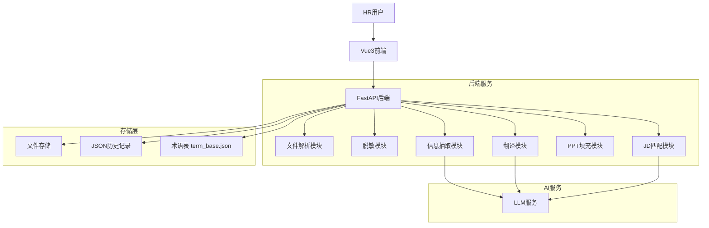
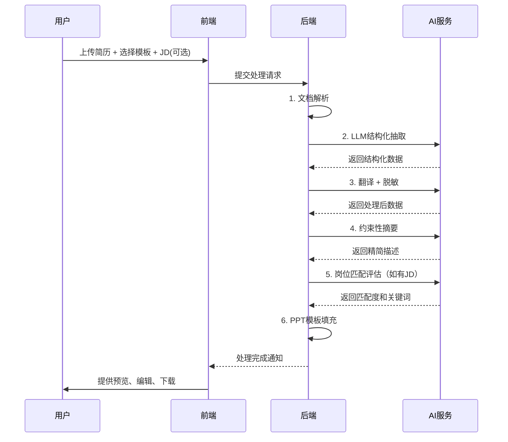

# AI简历模板转化工具 - 产品设计文档

## 1. 项目概述

### 1.1 项目背景
制作一个网页版AI简历模板转化工具，将自由格式简历经过AI处理后填充进公司固定模板。

### 1.2 目标用户
企业内部HR人员

### 1.3 部署环境
企业内网部署，确保数据安全

## 2. 功能需求

### 2.1 P0核心功能
- [ ] CV模板识别（JSON字段映射）
- [ ] 简历文件解析（PDF/Word/图片 → JSON）
- [ ] 个人信息脱敏
- [ ] 结构化信息抽取与整理
- [ ] 中英文翻译
- [ ] PPT模板填充（横向/纵向）
- [ ] 经历条目动态增减
- [ ] CV下载（PPT/PDF格式）

### 2.2 P1增强功能
- [ ] JD识别（文字/PDF）
- [ ] 岗位JD匹配与关键词高亮
- [ ] CV结果预览与在线编辑
- [ ] AI辅助优化建议
- [ ] 输出文件命名规范

### 2.3 P2高级功能
- [ ] 目标语言切换（CN ↔ EN）
- [ ] 处理进度实时展示
- [ ] 批量简历处理
- [ ] 翻译术语表管理
- [ ] 处理历史记录
- [ ] 数据统计报表
- [ ] 简历对比功能
- [ ] CV模板库管理
- [ ] JD库管理

## 3. 技术架构

### 3.1 技术栈
- **后端**：FastAPI + Pydantic + SQLAlchemy + unstructured + paddleocr + python-pptx
- **前端**：Vue3 + Vite + TypeScript + Pinia + ElementPlus
- **AI模型**：支持本地模型（Qwen/GLM）和Copilot API混合模式
- **环境管理**：conda（后端）+ pnpm（前端）

### 3.2 系统架构图


## 4. 核心功能设计

### 4.1 CV模板识别
- 模板PPT中预置JSON字段标记
- 系统自动识别字段位置和类型
- 支持自定义字段映射配置

### 4.2 简历文件解析
- **PDF解析**：unstructured + 可选paddleocr（扫描版）
- **Word解析**：unstructured
- **图片解析**：paddleocr
- 统一输出结构化JSON

### 4.3 个人信息脱敏
- **默认规则**：
  - 姓名 → Mr/Ms. + 姓氏拼音
  - 电话/邮箱/年龄/出生日期/所在地 → 移除
- **支持配置**：脱敏规则可通过配置文件调整

### 4.4 结构化信息抽取
- 按时间倒序排列项目经历和工作经历
- 智能合并重复内容
- 关键信息标注

### 4.5 PPT模板填充
- 支持两种模板：Onepager_Template（横向）、New_Template（纵向）
- 表格行数自适应
- 动态内容布局调整

#### 4.5.1 简历字段映射（PPT模板占位符）
ResumeData 模型字段与 PPT 模板占位符映射关系：

| 字段名 | PPT占位符 | 说明 |
|--------|-----------|------|
| `name` | {{姓名}} | 原始姓名 |
| `anonymized_name` | {{脱敏姓名}} | 脱敏后的姓名 |
| `phone` | {{电话}} | 电话（脱敏时移除） |
| `email` | {{邮箱}} | 邮箱（脱敏时移除） |
| `location` | {{所在地}} | 所在地（脱敏时移除） |
| `age` | {{年龄}} | 年龄（脱敏时移除） |
| `birth_date` | {{出生日期}} | 出生日期（脱敏时移除） |
| `position` | {{职位}} | 应聘职位 |
| `technical_area` | {{技术领域}} | 技术领域 |
| `total_exp` | {{总工作经验}} | 总工作经验年限 |
| `education` | {{教育经历列表}} | 教育经历列表 |
| `work` | {{工作经历列表}} | 工作经历列表 |
| `project` | {{项目经历列表}} | 项目经历列表 |
| `tech_skills` | {{技术技能}} | 技术技能 |
| `lang_skills` | {{语言技能}} | 语言技能 |
| `lang_skills_level` | {{语言水平}} | 语言水平 |
| `training_exp` | {{培训经历}} | 培训经历 |
| `summary` | {{个人简介}} | 个人简介 |

#### 4.5.2 脱敏规则
- **姓名脱敏**：Mr/Ms. + 姓氏拼音（如：张伟 → Mr. Zhang）
- **联系方式移除**：电话、邮箱、年龄、出生日期、所在地完全移除，不展示
- **公司名称脱敏**：按出现顺序递增映射：
  - 第1家公司 → Company A
  - 第2家公司 → Company B
  - 第3家公司 → Company C
  - 以此类推...
- **保留内容**：职业经历、技能、教育背景等关键信息完整保留

#### 4.5.3 约束性摘要规则
针对简历中所有经历（工作经历、项目经历）进行优化：
1. **语法修正**：修正语法错误、表达不通顺的地方
2. **格式统一**：统一标点符号、格式风格
3. **冗余删除**：删除重复或冗余的工作内容
4. **句式统一**：每段经历使用相同的句式表达（参考常见简历风格）
5. **内容保留**：在不大幅改动候选人简历原文内容的基础上进行优化

### 4.6 文件命名规范
`IAV_{脱敏姓名}_{岗位}_Resume_{语言}.pptx`

## 5. 数据结构设计

### 5.1 术语表 term_base.json
```json
{
  "version": "1.0",
  "terms": [
    {
      "cn": "中文术语",
      "en": "English Term",
      "category": "技术/职位/其他",
      "description": "说明"
    }
  ]
}
```

### 5.2 处理历史记录
```json
{
  "history": [
    {
      "id": "uuid",
      "timestamp": "2024-01-01T00:00:00",
      "original_file": "文件名",
      "file_size": "1.2 MB",
      "job_position": "岗位",
      "language": "CN/EN",
      "template": "纵向/横向",
      "jd_match_score": 85,
      "status": "completed/failed",
      "processing_time": "03:25",
      "output_file": "输出文件名"
    }
  ]
}
```

### 5.3 处理状态跟踪
```json
{
  "task_id": "uuid",
  "file_info": {
    "name": "文件名",
    "size": "1.2 MB",
    "format": "Word"
  },
  "config": {
    "template": "纵向",
    "language": "English",
    "job_position": "HUD Product Manager",
    "jd_text": "可选"
  },
  "pipeline": [
    {
      "step": 1,
      "name": "文档解析",
      "status": "completed",
      "description": "PDF/Word → 文本提取",
      "duration": "00:15"
    },
    {
      "step": 2,
      "name": "LLM结构化抽取",
      "status": "completed",
      "description": "识别姓名/经历/技能",
      "duration": "01:30"
    },
    {
      "step": 3,
      "name": "翻译+脱敏",
      "status": "in_progress",
      "description": "中文→英文，隐私脱敏",
      "duration": null
    },
    {
      "step": 4,
      "name": "约束性摘要",
      "status": "pending",
      "description": "3-5要点精简描述",
      "duration": null
    },
    {
      "step": 5,
      "name": "岗位匹配评估",
      "status": "pending",
      "description": "与JD关键词对比",
      "duration": null
    },
    {
      "step": 6,
      "name": "PPT模板填充",
      "status": "pending",
      "description": "按IAV模板生成",
      "duration": null
    }
  ],
  "overall_progress": 50,
  "elapsed_time": "02:12",
  "status": "processing"
}
```

### 5.4 CV模板库数据结构
```json
{
  "templates": [
    {
      "id": "uuid",
      "name": "New_Template_IAV_Resume_EN",
      "category": "纵向",
      "version": "v2.1",
      "update_time": "2026-05-20",
      "file_path": "templates/New_Template_IAV_Resume_EN.pptx",
      "status": "active"
    },
    {
      "id": "uuid",
      "name": "Onepager_Template_EN",
      "category": "横向",
      "version": "v1.9",
      "update_time": "2026-03-15",
      "file_path": "templates/Onepager_Template_EN.pptx",
      "status": "active"
    }
  ],
  "statistics": {
    "total": 2,
    "active": 2,
    "inactive": 0
  }
}
```

### 5.5 JD库数据结构
```json
{
  "jd_list": [
    {
      "id": "uuid",
      "title": "HUD产品经理",
      "category": "产品管理",
      "language": "CN",
      "is_hot": true,
      "description": "负责HUD、BTM产品管理，5年+",
      "create_time": "2026-05-16",
      "usage_count": 12,
      "last_used": "2026-06-15"
    },
    {
      "id": "uuid",
      "title": "ADAS算法工程师",
      "category": "汽车技术",
      "language": "CN",
      "is_hot": true,
      "description": "负责ADAS、深度学习、C++开发",
      "create_time": "2026-05-14",
      "usage_count": 8,
      "last_used": "2026-06-10"
    }
  ],
  "statistics": {
    "total": 28,
    "automotive": 12,
    "product": 8,
    "software": 8
  }
}
```

### 5.6 历史记录统计数据
```json
{
  "total": 156,
  "success_rate": 94,
  "monthly": 23
}
```

## 6. 处理流程Pipeline



### 6.1 6步处理Pipeline详细说明

| 步骤 | 名称 | 描述 | 状态 |
|------|------|------|------|
| 1 | 文档解析 | PDF/Word/图片 → 文本提取 | P0 |
| 2 | LLM结构化抽取 | 识别姓名/经历/技能等字段 | P0 |
| 3 | 翻译+脱敏 | 中英文互译，隐私信息脱敏 | P0 |
| 4 | 约束性摘要 | 3-5要点精简描述工作内容 | P0 |
| 5 | 岗位匹配评估 | 与JD关键词对比，计算匹配度 | P1 |
| 6 | PPT模板填充 | 按IAV模板生成最终简历 | P0 |

### 6.2 前端页面结构

```
┌──────────────────────────────────────────────────────────┐
│  顶部导航：问候语、通知、用户头像                          │
├──────────┬───────────────────────────────────────────────┤
│          │  主内容区（根据当前页面变化）                   │
│  左侧    │                                               │
│  导航    │  1. 上传配置页面 - 文件上传+模板选择+JD输入    │
│  菜单    │  2. 处理进度页面 - 6步Pipeline+进度条          │
│          │  3. 结果预览与编辑 - PPT预览+编辑+下载         │
│  - 上传  │  4. 历史记录页面 - 处理记录+筛选+统计         │
│  - 处理  │  5. CV模板库 - 模板管理+上传新版本            │
│  - 预览  │  6. JD库 - JD管理+分类筛选                    │
│  - 历史  │                                               │
│  - 模板库│                                               │
│  - JD库  │                                               │
└──────────┴───────────────────────────────────────────────┘
```

### 6.3 UI设计规范

| 元素 | 颜色/样式 |
|------|-----------|
| 主题色 | #7C5CFC (紫色) |
| 背景色 | #F0F2F5 (浅灰) |
| 卡片背景 | #FFFFFF (白色) |
| 侧边栏背景 | #1E1E2D (深灰) |
| 成功色 | #22C55E (绿色) |
| 警告色 | #F59E0B (橙色) |
| 危险色 | #EF4444 (红色) |
| 按钮样式 | 圆角、紫色填充、白色文字 |
| 卡片样式 | 圆角、轻微阴影 |
| 进度条 | 紫色填充，圆角 |

## 7. 开发计划

### 阶段1：P0核心功能（MVP）
1. 项目脚手架搭建
2. 文件解析模块
3. 基础LLM集成
4. PPT模板填充
5. 前端基础界面

### 阶段2：P1增强功能
1. JD匹配模块
2. 在线编辑功能
3. AI辅助建议

### 阶段3：P2高级功能
1. 批量处理
2. 历史记录
3. 数据统计
4. 简历对比

## 8. 项目结构

```
ai_resume/
├── backend/                 # 后端服务
│   ├── app/
│   │   ├── api/            # 路由
│   │   ├── schemas/        # Pydantic模型
│   │   ├── services/       # 业务逻辑
│   │   └── models/         # 数据模型
│   ├── templates/          # PPT模板
│   ├── data/               # 数据存储
│   └── requirements.txt
├── frontend/               # 前端应用
│   ├── src/
│   │   ├── components/
│   │   ├── stores/         # Pinia
│   │   ├── api/            # API封装
│   │   └── types/          # TS类型
│   └── package.json
└── memory-bank/            # 项目文档
    ├── architecture.md     # 架构文档
    ├── design-document.md  # 本文档
    ├── tech-stack.md       # 技术栈
    ├── implementation-plan.md # 实施计划
    └── progress.md         # 进度跟踪
```

## 9. 成功指标

- P0功能完成度：100%
- 简历处理准确率：≥90%
- 单份简历处理时间：≤2分钟
- 用户满意度：≥4/5

## 10. API规范

### 10.1 标准化错误响应格式

所有API错误统一使用以下JSON格式返回：

```json
{
  "success": false,
  "error_code": "VALIDATION_ERROR",
  "message": "请求参数验证失败",
  "details": {
    "field_errors": [
      {
        "field": "file_id",
        "message": "文件ID不能为空"
      }
    ]
  },
  "timestamp": "2026-06-23T10:30:00Z"
}
```

#### 10.1.1 错误码定义

| error_code | HTTP状态码 | 说明 |
|------------|------------|------|
| `VALIDATION_ERROR` | 400 | 请求参数验证失败 |
| `FILE_NOT_FOUND` | 404 | 未找到指定文件 |
| `TEMPLATE_NOT_FOUND` | 404 | 未找到指定模板 |
| `JD_NOT_FOUND` | 404 | 未找到指定JD |
| `TASK_NOT_FOUND` | 404 | 未找到指定任务 |
| `FILE_TYPE_INVALID` | 400 | 不支持的文件类型 |
| `FILE_SIZE_EXCEEDED` | 400 | 文件大小超出限制 |
| `PARSE_ERROR` | 422 | 文档解析失败 |
| `LLM_ERROR` | 500 | LLM调用失败 |
| `PPT_FILL_ERROR` | 500 | PPT模板填充失败 |
| `INTERNAL_ERROR` | 500 | 内部服务器错误 |

#### 10.1.2 成功响应格式

所有API成功响应统一使用以下格式：

```json
{
  "success": true,
  "data": { /* 响应数据 */ },
  "message": "操作成功",
  "timestamp": "2026-06-23T10:30:00Z"
}
```

### 10.2 FastAPI异常处理规范

使用 FastAPI 的 HTTPException 捕获异常，示例：

```python
from fastapi import HTTPException, status

# 参数验证失败
raise HTTPException(
    status_code=status.HTTP_400_BAD_REQUEST,
    detail={
        "success": False,
        "error_code": "VALIDATION_ERROR",
        "message": "请求参数验证失败",
        "details": { ... },
        "timestamp": datetime.utcnow().isoformat() + "Z"
    }
)

# 资源未找到
raise HTTPException(
    status_code=status.HTTP_404_NOT_FOUND,
    detail={
        "success": False,
        "error_code": "FILE_NOT_FOUND",
        "message": "未找到指定文件",
        "details": { "file_id": "xxx" },
        "timestamp": datetime.utcnow().isoformat() + "Z"
    }
)
```
