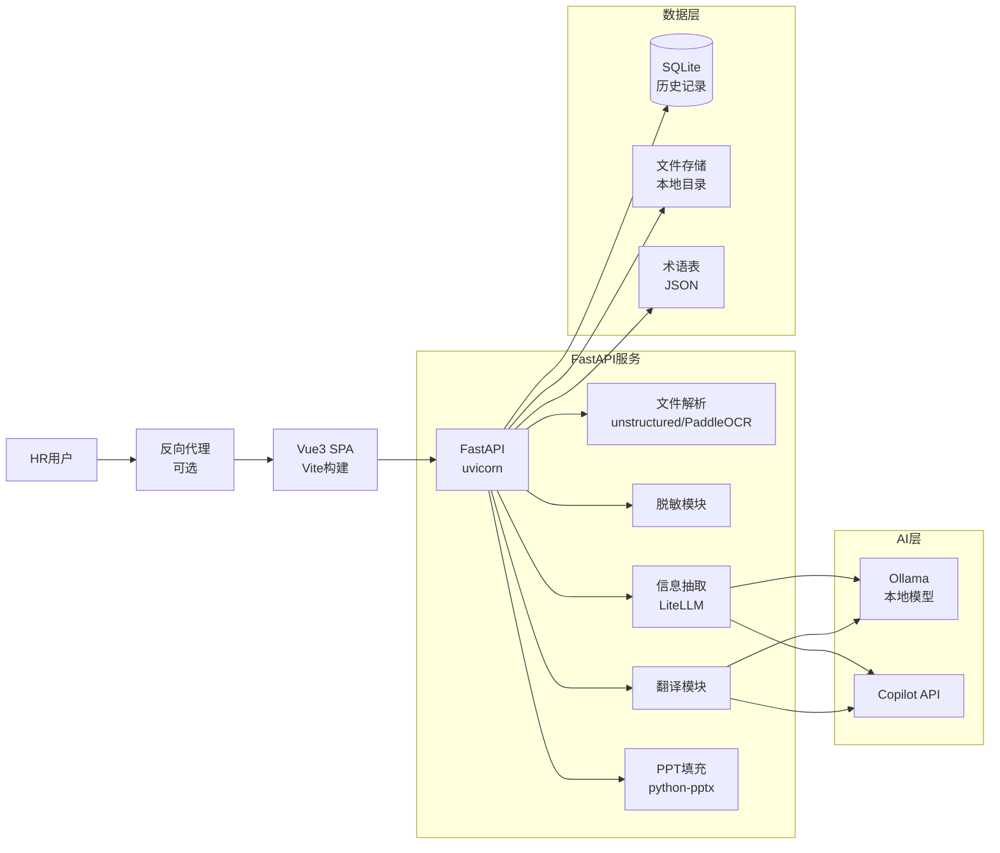

# 技术栈选型方案

## 1. 技术栈总览

### 核心理念
**简单优先，兼顾健壮** - 选择成熟稳定、文档完善的技术方案，避免过度设计。

---

## 2. 后端技术栈

### 2.1 Web框架
| 技术 | 选型 | 理由 |
|------|------|------|
| Web框架 | **FastAPI** | 异步支持、自动生成Swagger文档、Pydantic集成完美 |
| 数据验证 | **Pydantic v2** | 类型安全、性能优秀 |
| ORM | **SQLAlchemy 2.0** | 成熟稳定、异步支持 |
| 数据库 | **SQLite** | 轻量级、零配置、适合中小规模 |

### 2.2 文件处理
| 功能 | 选型 | 理由 |
|------|------|------|
| PDF解析 | **unstructured[pdf]** | 开源、本地部署、结构化输出好 |
| Word解析 | **unstructured[docx]** | 同上，统一接口 |
| OCR | **PaddleOCR** | 百度开源、中文识别准确率高 |
| PPT操作 | **python-pptx** | 标准库、功能完善 |

### 2.3 AI服务
| 功能 | 选型 | 理由 |
|------|------|------|
| LLM调用 | **LiteLLM** | 统一接口、支持多种模型（本地+Copilot） |
| 本地LLM | **Ollama** | 部署简单、模型管理方便 |

### 2.4 后端依赖
```txt
fastapi>=0.109.0
uvicorn[standard]>=0.27.0
sqlalchemy>=2.0.25
aiosqlite>=0.19.0
pydantic>=2.5.0
pydantic-settings>=2.1.0
python-multipart>=0.0.6
python-pptx>=0.6.23
unstructured[pdf,docx]>=0.12.0
paddleocr>=2.7.0
paddlepaddle>=2.6.0
litellm>=1.26.0
python-jose[cryptography]>=3.3.0
passlib[bcrypt]>=1.7.4
python-multipart>=0.0.6
```

---

## 3. 前端技术栈

### 3.1 核心框架
| 技术 | 选型 | 理由 |
|------|------|------|
| 构建工具 | **Vite 5** | 开发体验好、构建快 |
| 前端框架 | **Vue 3** | Composition API、TypeScript支持好 |
| 类型系统 | **TypeScript 5** | 类型安全 |
| UI组件库 | **Element Plus** | 组件丰富、中文文档完善 |
| 状态管理 | **Pinia** | Vue官方推荐、简单直观 |
| HTTP客户端 | **Axios** | 成熟稳定、拦截器支持完善 |
| 路由 | **Vue Router 4** | 官方路由、TypeScript支持好 |

### 3.2 增强库
| 功能 | 选型 | 理由 |
|------|------|------|
| 进度展示 | **NProgress** | 轻量级进度条 |
| 文件上传 | **VueUse** | 组合式工具库 |
| 日期处理 | **day.js** | 轻量、API友好 |

### 3.3 前端依赖
```json
{
  "dependencies": {
    "vue": "^3.4.0",
    "vue-router": "^4.2.0",
    "pinia": "^2.1.0",
    "axios": "^1.6.0",
    "element-plus": "^2.5.0",
    "@element-plus/icons-vue": "^2.3.0",
    "@vueuse/core": "^10.7.0",
    "dayjs": "^1.11.0",
    "nprogress": "^0.2.0"
  },
  "devDependencies": {
    "@vitejs/plugin-vue": "^5.0.0",
    "typescript": "^5.3.0",
    "vite": "^5.0.0",
    "vue-tsc": "^1.8.0"
  }
}
```

---

## 4. 开发工具

### 4.1 环境管理
| 工具 | 选型 | 理由 |
|------|------|------|
| Python环境 | **conda** | 依赖隔离、便于管理 |
| Node.js环境 | **volta** / **nvm** | 版本管理灵活 |
| 包管理 | **pnpm** | 速度快、节省磁盘 |

### 4.2 代码质量
| 工具 | 选型 | 理由 |
|------|------|------|
| Python格式化 | **black** + **ruff** | 快速、统一 |
| TypeScript格式化 | **eslint** + **prettier** | 生态成熟 |

---

## 5. 部署方案

### 5.1 容器化（可选）
```dockerfile
# 多阶段构建，镜像精简
```

### 5.2 推荐部署流程
1. **开发环境**：本地直接运行
2. **测试环境**：Docker Compose
3. **生产环境**：企业内网Docker部署

---

## 6. 架构简图



---

## 7. 备选方案

### 7.1 如果需要更强的OCR
- 备选：**Tesseract** + **Chinese trained data**

### 7.2 如果需要更好的PDF处理
- 备选：**PyMuPDF (fitz)** - 速度更快

### 7.3 如果需要大规模部署
- 数据库升级：**PostgreSQL**
- 任务队列：**Celery** + **Redis**

---

## 8. 总结

本技术栈选型遵循以下原则：
1. ✅ **成熟稳定** - 所有选型都经过广泛验证
2. ✅ **文档完善** - 社区活跃，问题易解决
3. ✅ **维护成本低** - 避免过于小众的技术
4. ✅ **可扩展** - 预留升级空间但不过度设计
5. ✅ **数据安全** - 支持本地模型，敏感数据不出网
